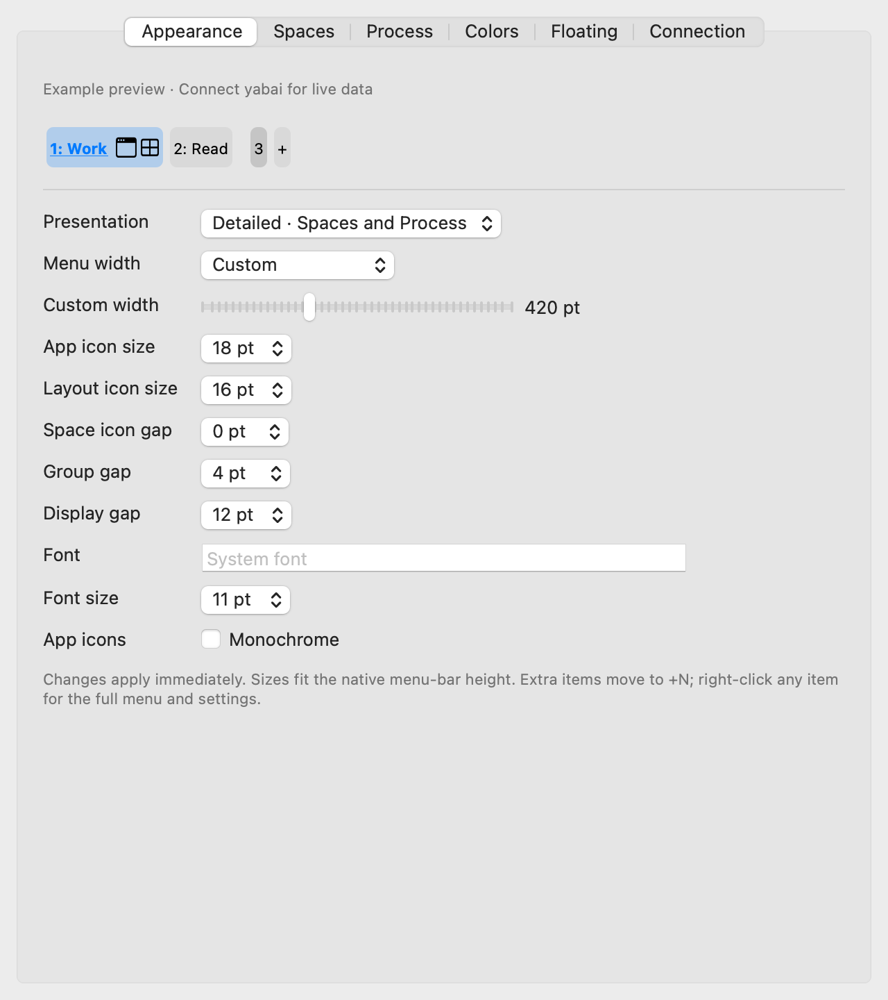

# Yabai Menu

Spaces and window state in the native macOS menu bar or per-display bars. A small companion to [yabai](https://github.com/asmvik/yabai).

- Show each Space with its app icons and distinguish focused, visible and inactive Spaces.
- Click individual Spaces or windows directly. Right-click a Space to rename, move, create or delete it.
- Show the focused app and optional title, independent Space/window layouts, sticky state and stack numbers.
- Filter empty Spaces, duplicate apps, labels and titles; keep sticky apps in a separate group.
- Customize detailed or compact presentation, width, fonts, icons, spacing, background, borders and corners.
- Show only each display's Spaces, or show all displays with independent current-Space highlights. Dock bars at the top or drag floating bars to saved positions.
- Choose Catppuccin or Tokyo Night colors, adjust Space names separately, and remove unfocused backgrounds.
- Recover from yabai restarts using socket and process events, with no periodic polling.
- Open the full menu for all windows, connection status and privacy-conscious diagnostics.



The screenshot uses example data. Version 1.0.0 is a local release candidate; it has not been published or notarized.

## Requirements

- macOS 13 or later is the build target. The 1.0 candidate is tested locally on Intel macOS 14.8.5. The candidate also launches on Apple Silicon macOS 15.7.9. macOS 13 runtime testing remains pending.
- A running yabai installation. JSON compatibility has been checked against yabai 7.1.16 and 7.1.25.
- Space and window actions use the capabilities and permissions of your existing yabai setup. See the [upstream setup guide](https://github.com/asmvik/yabai/wiki).

Yabai Menu does not install yabai or change its configuration files. Native movement/title tracking reuses a-bar's Accessibility event path and needs permission for **Yabai Menu itself**. In **Settings → Connection**, click **Enable Native Window Updates…**, enable the app in macOS Accessibility, then click **Check Connection**. Opening Settings does not request permission. The app does not request Screen Recording access. It registers its own labelled yabai signals while running. A standard installation is detected at `/opt/homebrew/bin/yabai` or `/usr/local/bin/yabai`; another executable can be selected in Settings.

## Build and run

From this checkout, with Xcode selected:

```sh
sh build.sh
open 'dist/Yabai Menu.app'
```

The build produces a universal x86_64 + arm64 app, versioned ZIP and `.sha256` file in `dist/`. It checks both architectures, the plist, signature and ZIP before replacing previous outputs. It uses local ad-hoc signing. For normal use, quit the app and copy `Yabai Menu.app` to `/Applications`, then launch it:

```sh
open -a '/Applications/Yabai Menu.app'
```

To update a local preview, quit the old app before replacing it. Quit normally before removing the app so its signal registrations can be cleaned up. After a forced termination, launch and quit once to clean up retained signals. Preferences remain in the app's UserDefaults domain.

Launch at login is opt-in. Opening Settings only reads the current macOS login-item state; it does not change that state.

## Appearance

Changes apply immediately and are saved locally. They do not query or reconnect yabai. The preview uses the latest snapshot, marks retained data as **Last known preview**, and uses labelled example data before the first successful connection.

| Setting | Choices |
| --- | --- |
| Presentation | Detailed groups with optional two-line Process; compact single-line groups; both individually clickable |
| Menu width | Compact 180 pt, standard 280 pt, custom 120–1000 pt |
| Placement | Native menu bar, per-display top bar, or draggable per-display floating bar |
| Spaces | All displays with independent current-Space highlights, this display only, or hidden; number, label, or both |
| Space icons | Show/hide, hide empty Spaces, deduplicate apps, separate sticky group, per-window layout text/icon, show/hide create button |
| Exclusions | Comma-separated app names / Space labels; title substrings; optional regular expressions |
| Process | Hidden by default; current Space, all Spaces, or focused window; focused app name, optional title, or icon only |
| Layout | Independent Space and focused-window layout as text, icon, or hidden |
| Style | 8–32 pt app/layout icons, 0–16 pt Space icon gaps, 0–24 pt group gaps, 0–64 pt display gaps, custom font and 8–24 pt text |
| Colors | System, Catppuccin Mocha/Latte, Tokyo Night/Storm; separate background and Space-name colors |
| Group background | Separate focused/unfocused opacity (0% removes fill and border), 0–18 pt corners, borders, 0–100% unfocused-window brightness |
| Floating | 24–64 pt content height, 20–100% window opacity, position lock, optional visibility above fullscreen apps |
| Bar backdrop | Frosted glass, solid or none; 0–100% glass tint, 0–24 pt corners, side/vertical padding, subtle border and native shadow |

Both presentations share the same controls. Icons and text fit the native menu-bar height; large text shrinks further when necessary to preserve clickable icons within a narrow width. Use System Colors restores automatic light/dark colors. Changes use the cached snapshot and do not reconnect yabai.

Selecting a different theme resets the six custom background/name overrides; opacity stays unchanged. Custom colors then override the selected theme. Existing linked name/background colors migrate without changing their appearance.

Top and floating bars default to a rounded glass backdrop with a subtle border and native window shadow. **Glass tint** changes only the background; **Window opacity** also fades text and icons. Solid stays opaque, and macOS Reduce Transparency uses a solid backdrop. Padding adds to content height. **None** removes the backdrop and its shadow. Latte uses its dark text color for all Space names; the current Space remains distinguished by its background and focus marker. The preview shows the backdrop and spacing; the window shadow is visible on the actual bar.

Space exclusions match the full app name or Space label; title exclusions match substrings. Regex mode ignores invalid patterns. Empty-space detection uses actual visible occupancy before icon exclusions; focused and visible Spaces are retained. The separate sticky group is deduplicated independently. When duplicate apps are collapsed, the focused window represents its app. Process keeps hidden/minimized windows, while Space icon groups omit them. The full menu remains unfiltered.

## Reading and using the menu bar

The detailed view groups each Space's name and apps under one background. Every display's current Space gets the selected name marker (brackets, bold or underline), including when its background is transparent. A per-display bar accents its own current Space; the other displays' current Spaces retain the separate visible-Space color. The native all-displays menu bar uses global keyboard focus for its accent. Optional **Display divider** lines separate the remaining display groups and yield to current-Space labels at narrow widths. Window icon brightness follows the actual keyboard focus. Click a name to focus the Space, click an app icon to focus that window, or right-click the group for management actions. **Manage Spaces** in the full menu provides the same actions. In a per-display bar, Process and the `+` button follow that bar's display.

Each Space app icon can show its own `float / stack / bsp` layout. Process is optional and hidden by default. When enabled, it shows the focused app above its optional window title in Detailed, or on one line in Compact. `float / stack / bsp` describes the focused window; a pin marker indicates sticky independently, and nonzero stack numbers stay visible. The separately labelled **Space** badge describes the current desktop's layout. Layout can also be shown with icons.

Content fits the selected width. It retains the focused Space and any eligible focused window icon; `+N` opens the full menu for omitted entries. Only visible icons are requested and images are cached by process. Space groups and Process can both represent the same window. Both presentations support direct clicks and omit the fixed chevron. Right-click any item for **Open Full Menu**, **Settings…** and **Quit**; an empty bar shows a **Yabai** menu button.

Space actions are serialized. Each action resolves a stable Space ID against a fresh query, including another check after display focus before deletion. Adjacent focus requests coalesce; mutations are not dropped or automatically retried. Separate yabai commands cannot form an atomic transaction with unrelated external commands. Permission and capability errors remain visible; the app does not change SIP or install a scripting addition.

**Menu bar → This display only** keeps the bar in the system menu row and shows each screen's own Spaces. macOS mirrors the native status item, so the app reserves one slot and draws each screen's content in a transparent panel within that slot. There is no trailing ellipsis or extra menu-button space. Left-click selects the Space or window; right-click or Control-click opens management and menu access, including when an event lands on the underlying native slot. Panels follow the application's actual status-window geometry and hide when a slot is hidden, offscreen or ambiguous; no window-list polling is used. Holding Command keeps the content visible and lets mouse events pass through to the native slot for system reordering. This mode does not change to a docked bar.

Top and floating bars retain a small **Yabai** menu entry. Floating bars use the dotted handle, store positions by display UUID, and stay within the available screen after monitor changes. They do not reserve space in yabai's window layout. Floating fullscreen visibility is opt-in. macOS and menu-bar managers still control the native menu bar's automatic hiding and available width.

Floating bars can be dragged into the menu-bar area and keep that position after release or relaunch. Their level rises only while overlapping that area; docked bars keep their existing placement. Right-click a Space, icon, handle or background and toggle **Lock Floating Bar Position**; the checkmark and Settings checkbox share the same saved value. Existing positions stay unchanged until the bar is moved. The appearance preview fits its actual height, and the underline marker uses a solid 2 pt line under each current Space name.

## Event-driven updates

There is no periodic query or signal-registration heartbeat. Updates come from yabai signals, application/Space/display notifications, explicit menu interaction, and successful actions. Socket replacement and daemon process exit trigger recovery. Screen sleep suspends queries; screen wake resumes them.

The window-event core is adapted from a-bar. A background AX observer handles movement and title changes, with one subscription per application. Failed subscriptions put the connection in a limited state and use the bounded recovery attempts below; a successful data query alone does not clear a subscription failure. Movement uses a 300 ms trailing delay. Native title changes update the matching window's cached title without a yabai query; PID and revision checks prevent old reads from overwriting newer titles. Focus notifications carry a window ID and query that window first; uncertain identity or Space/display membership falls back to a full snapshot. Structural updates take priority over partial reads. The former mouse-event and pressed-button implementation has been removed.

Snapshots request only the fields used by the UI. Full updates read Spaces, windows and displays together, as a-bar does; display focus must stay fresh for subsequent single-window updates. The app retires its own old movement/resize shell signals and, when native title mapping is available, its title shell signal. The AX-to-window-ID lookup uses the same optional `_AXUIElementGetWindow` SPI as a-bar; if unavailable, titles use window-query updates. Geometry-only updates keep existing buttons and icons; closed settings windows do not render previews. Programmatic layout/float/sticky changes should send the refresh hook below.

Timers cover command deadlines, 80 ms structural-event coalescing, the 300 ms native movement delay, and at most three recovery retries (1, 2 and 4 seconds). This app retains its existing socket/process recovery and serialized Space actions; it does not copy a-bar's periodic signal-registration check. After retries are exhausted, a new relevant event or **Check Connection** starts another recovery attempt.

### Commands that need a notification hook

yabai does not expose dedicated signals for every layout, float or sticky change. Window transfers can also leave geometry unchanged. A bare external command may therefore remain invisible until another event or **Refresh**.

Use **Copy Refresh Hook** to get the notification command for your account, and append it after a successful external change. For example, this invocation also works when your interactive shell is fish:

```sh
sh -c 'yabai -m window --toggle float && /usr/bin/notifyutil -p "user.uid.$(/usr/bin/id -u).dev.gladio.yabai-menu.refresh"'
```

Use the same pattern for layout, sticky, and window-transfer scripts. Existing a-bar hooks using `user.uid.<uid>.com.jeantinland.a-bar.yabai` are also accepted, so they do not need to be rewritten. No hook is installed into your shell or skhd configuration automatically.

## Troubleshooting

Open the menu to see connection state and the last successful update time. The bar does not show exclamation badges. A failed query keeps the last valid snapshot; its unavailable state and details remain in the menu and Settings. An action error remains visible there until dismissed or another action is requested; a successful background read does not hide it.

**Copy Diagnostics** includes the version and build, current process architecture, Accessibility permission, native subscription status, signal/notification readiness and error categories. It reads cached state without querying yabai or requesting permission. Window titles, Space labels and raw command errors are excluded.

- **yabai not found:** install yabai or choose its executable in Settings.
- **Disconnected:** check that yabai is running, then use **Check Connection**.
- **Event connection needs attention:** signal or notification setup failed. The app does not silently switch to polling. Use **Check Connection** to retry.
- **Native window updates need Accessibility access:** enable Yabai Menu through the Connection settings button and macOS Accessibility, then use **Check Connection**. Until enabled, native movement/title updates are unavailable; the menu and explicit refresh remain usable.
- **Display asleep:** the last snapshot is retained and queries resume on a wake event.
- **A toggle did not update:** add the notification hook above, or use **Refresh**.
- **No menu item:** reveal an automatically hidden menu bar and check whether other items have consumed its available space.

**Copy Diagnostics** includes app/macOS versions, a home-relative executable path, connection state, update age, and item counts. It excludes window titles and application names. Review any extra logs or screenshots before attaching them to an issue.

## Development and tests

```sh
swift test
```

Unit tests cover decoding, invalid data, width budgets, appearance persistence, stale-snapshot selection, the serialized action queue, stale Space IDs, partial mutation failures, bounded retries, display recovery, command deadlines and filesystem/process events. They also cover per-display state, theme migration, floating drag persistence, monitor geometry and button reuse. Ported a-bar tests cover native observer lifecycle, title deduplication, JSON compatibility and window-ID lookup failure; service regressions cover targeted focus, stale-title reconciliation and stopped callbacks. Rendering checks exercise up to 500 windows and 80 Spaces. These checks do not establish physical drag latency or performance parity with a-bar. Interactive UI and real-yabai tests are opt-in:

```sh
env YABAI_MENU_UI_TESTS=1 swift test
```

For the live integration check, first quit Yabai Menu. Choose the installed yabai path explicitly:

```sh
env YABAI_MENU_UI_TESTS=1 YABAI_MENU_LIVE_PATH=/opt/homebrew/bin/yabai swift test
```

The live test temporarily registers only `yabai-menu-*` signals and checks cleanup. It does not switch real Spaces or windows. The workflow is configured to run the noninteractive tests and universal build on Intel and Apple Silicon runners. Hosted CI has not run for this candidate.

See [RELEASING.md](RELEASING.md) for release checks and [CHANGELOG.md](CHANGELOG.md) for changes.

## License and credits

GPL-3.0-only; see [LICENSE](LICENSE). The Space/window presentation is based on [a-bar](https://github.com/Jean-Tinland/a-bar). The native observer, refresh ordering, title/focus reconciliation and JSON compatibility code are adapted from the existing a-bar implementation, with model and lifecycle integration for this app. This app does not bundle a-bar assets. Window data and actions are supplied by yabai. Application icons are read from running applications; the app icon is generated from the paths in `scripts/make-icon.swift`.

Theme RGB values come from [Catppuccin's palette](https://github.com/catppuccin/palette) (MIT) and [Tokyo Night](https://github.com/folke/tokyonight.nvim) (Apache-2.0). The floating-window behavior was compared with [Quosparr](https://github.com/Licoy/Quosparr); this app uses its own AppKit implementation and does not include Quosparr code or its Go runtime.
